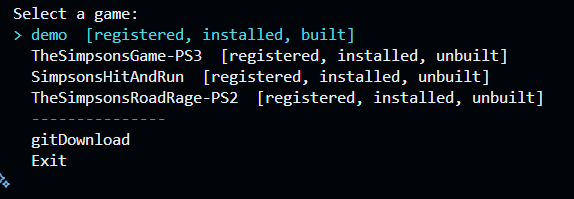
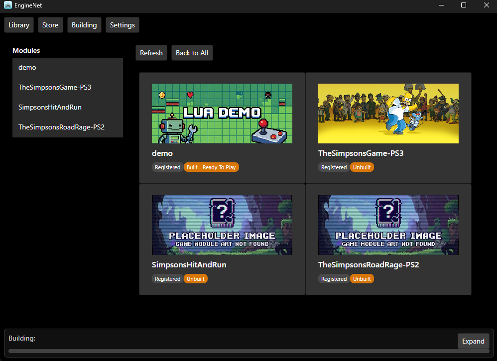
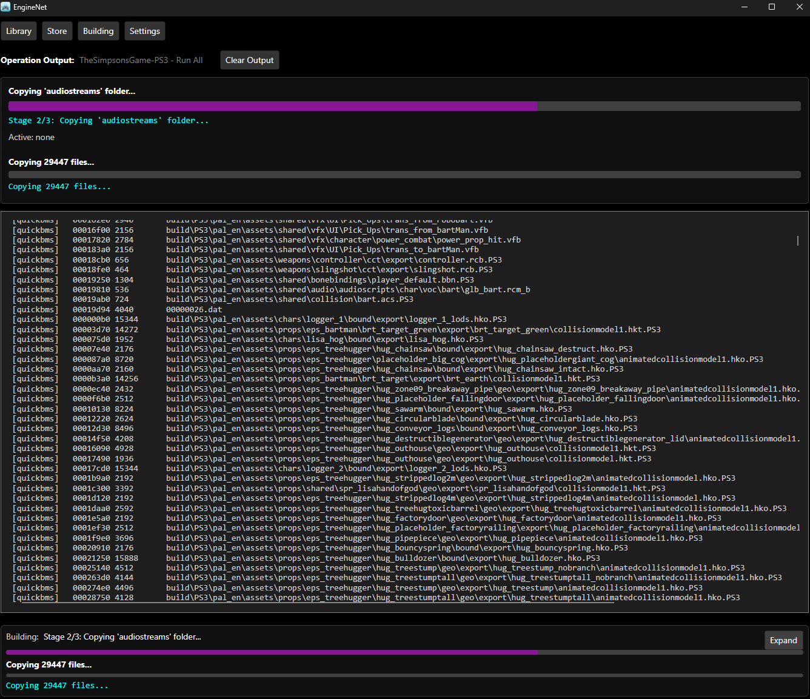

# Remake Engine

[](.betterGit/project.toml)
[](https://github.com/yggdrasil-au/RemakeEngine/commit/bbbf037)
[](https://dotnet.microsoft.com/en-us/download/dotnet/10.0)
[](LICENSE)

> **Baseline Version: Version 2.22.1 (Commit `bbbf037`)**  
> Dynamic Build Format: `T<Time>.D<Date>.C<Commit>.V<Version>` (generated at compile-time via `Directory.Build.targets` from `.betterGit/project.toml`).

**Remake Engine** is an extensible, cross-platform orchestration engine and reverse-engineering pipeline framework for executing repeatable game reconstruction and asset extraction workflows. Built on a high-performance **.NET 10 LTS** core (**EngineNet**), the engine provides unified execution across an Avalonia-based cross-platform GUI, an interactive split-screen Terminal UI (TUI), and a developer-focused Command-Line Interface (CLI).

---

## Table of Contents

- [Key Capabilities](#key-capabilities)
- [EngineNet Subproject Architecture & Dependency Graph](#enginenet-subproject-architecture--dependency-graph)
  - [Architectural Tiers](#architectural-tiers)
  - [Dependency Flow Graph](#dependency-flow-graph)
  - [Subproject Matrix](#subproject-matrix)
- [Optical Disc Image Subsystem (`EngineNet.Core.DiscImages`)](#optical-disc-image-subsystem-enginenetcorediscimages)
  - [Supported Console Formats & Sector Geometry](#supported-console-formats--sector-geometry)
  - [Core Subsystem Capabilities](#core-subsystem-capabilities)
  - [Lua Disc Image API](#lua-disc-image-api)
  - [Built-In CLI Disc Operations](#built-in-cli-disc-operations)
- [Module Registry, Categorization & Submodules](#module-registry-categorization--submodules)
  - [Registry Schema & Categorization (`Main.jsonc`)](#registry-schema--categorization-mainjsonc)
  - [Module State Lifecycle](#module-state-lifecycle)
  - [Nested Submodule Architecture & Discovery](#nested-submodule-architecture--discovery)
  - [Directory Pruning Rules](#directory-pruning-rules)
- [User Interfaces: CLI, TUI, and GUI](#user-interfaces-cli-tui-and-gui)
  - [Developer CLI Reference](#developer-cli-reference)
  - [Interactive TUI (Terminal.Gui & Spectre.Console)](#interactive-tui-terminalgui--spectreconsole)
  - [Avalonia Desktop GUI](#avalonia-desktop-gui)
- [Getting Started](#getting-started)
  - [Prerequisites & Platform Support](#prerequisites--platform-support)
  - [Clone, Build & Test](#clone-build--test)
  - [Launch Examples](#launch-examples)
- [Repository Layout](#repository-layout)
- [Continuous Integration & Releases](#continuous-integration--releases)
- [Configuration & Schemas](#configuration--schemas)
- [Contributing](#contributing)
- [Module Licensing Policy & Legal](#module-licensing-policy--legal)

---

## Key Capabilities

- **Pure Managed Optical Disc Image Subsystem**: Native C# sector parser supporting Xbox Original (XISO, XGD1), Xbox 360 (XGD2, XGD3), PlayStation 3 hybrid (ISO-9660/Joliet/UDF), PlayStation 2, and ECMA-119 ISO-9660 with zero unmanaged dependencies.
- **Virtual Stream Slicing (`SubStream`)**: High-performance, seekable, non-allocating windowed byte slicing across multi-gigabyte optical media without copying images to RAM.
- **Categorized Game Module Registry**: Central registry (`EngineApps/Registries/Modules/Main.jsonc`, with legacy fallback to `Main.json`) supporting JSONC comments, trailing commas, category containers (`Demo`, `SimpsonsGames`, `Lego`), category inheritance, and nested submodules.
- **Multi-Level Submodule Integration**: Automatic recursive Git cloning (`--recurse-submodules`), BFS directory scanning up to depth 4, and intelligent asset directory pruning.
- **Embedded Polyglot Scripting**: First-class embedded Lua (MoonSharp 2.0) with rich SDK helpers (`iso`, `sdk.iso`, `sdk.extract_iso`, file hashing, path helpers), alongside JavaScript (Jint 4.17) and Python (IronPython 3.4.2).
- **Format Converters & Codecs**: Built-in asset parsers for RenderWare TXD, Radical Pure3D (P3D), DirectDraw Surface (DDS), and BC1–BC7 texture compression.
- **External Tool Orchestration**: Automated downloader and execution manager for pipeline tools (QuickBMS, FFmpeg, vgmstream, ImageMagick) with placeholder path resolution.
- **Three Unified UX Modes**: Avalonia desktop GUI, split-screen TUI with category navigation, and headless CLI for scripting and automation.

---

## EngineNet Subproject Architecture & Dependency Graph

The Remake Engine solution (`RemakeEngine.slnx`) comprises **17 specialized C# projects** targeting `.NET 10.0` (`net10.0`). The codebase is strictly partitioned across five architectural tiers to enforce clean separation of concerns, rapid unit testing, and modular reuse.

### Architectural Tiers

1. **Tier 0: Foundational & Data Models**
   - `EngineNet.Shared`: Low-level serialization (TOML via Tomlyn, YAML via YamlDotNet, JSON), Windows extended-length path IO (`LongPathIO`), diagnostics, and UI logging abstractions.
   - `EngineNet.Core.Data`: Core domain data records and state models (`GameModules`, `GameModule`, `GameModuleInfo`, `Operation`, `Step`, `Prompt`, configuration models).
2. **Tier 1: Core Abstractions & Low-Level IO / Disc Images**
   - `EngineNet.Core.Abstractions`: Engine service contracts (`IOperationLoader`, `IToolRunner`, `IGameLauncher`, and interface definitions).
   - `EngineNet.Core`: Low-level file routines and the complete pure C# **Optical Disc Image Subsystem** (`EngineNet.Core.DiscImages`).
3. **Tier 2: Domain Services, Tooling & Formats**
   - `EngineNet.Core.ExternalTools`: External tool discovery, remote tool fallbacks, archive extraction (`SharpCompress`), and process spawning.
   - `EngineNet.Core.Utils`: Dynamic placeholder replacement (`{{Game_Root}}`, `{{Project_Root}}`), folder renaming utilities, hash validators, and module registry parsing (`Registries.cs`).
   - `EngineNet.Core.Media`: Media pipeline orchestration, audio/video conversions, and SQLite metadata indexing.
   - `EngineNet.Core.Services`: High-level manifest loading (`OperationsLoader`), tool registry synchronization, and game module discovery.
   - `EngineNet.GameFormats` (Assembly: `EngineNet.Formats`): Texture format decoders (RenderWare TXD, Radical P3D, DDS) and BC1–BC7 block compression (ImageSharp, BCnEncoder).
4. **Tier 3: Execution Runtimes & Operations**
   - `EngineNet.Core.Engine`: Game launcher (`GameLauncher`), process lifecycle monitoring, and game environment configuration.
   - `EngineNet.Core.Operations`: Central execution engine (`OpDispatcher`), step sequencer, and built-in operation handlers (`extract-iso`, `inspect-iso`, `format-extract`, `validate-files`, `rename-folders`).
   - `EngineNet.ScriptEngines`: Embedded multi-language script runtimes: Lua (MoonSharp 2.0 with custom SDK bindings & `iso` module), JavaScript (Jint 4.17), and Python (IronPython 3.4.2).
5. **Tier 4: User Interfaces & Executable Host**
   - `EngineNet.Interface`: Shared UI contracts (`Interface.Main`), asynchronous job queuing, viewmodels, and command routing.
   - `EngineNet.Interface.Terminal`: Spectre.Console CLI formatting and interactive split-screen Terminal UI (Terminal.Gui 2.5) with categorized views.
   - `EngineNet.Interface.GUI`: Cross-platform desktop application built with Avalonia UI (12.1) and ReactiveUI.
   - `EngineNet`: Executable host entry point (`Program.cs`, `Init.cs`), CLI argument router, and UI mode dispatcher.
6. **Tier 5: Testing**
   - `EngineNetTest`: Comprehensive test suite (24 unit tests) covering optical disc images, filesystem safety, format decoding, and module registries.

### Dependency Flow Graph

```text
┌────────────────────────────────────────────────────────────────────────┐
│                        EngineNet (Host Executable)                     │
└─────┬──────────────┬──────────────┬─────────────┬─────────────┬────────┘
      │              │              │             │             │
      ▼              ▼              ▼             ▼             ▼
┌───────────┐ ┌─────────────┐ ┌───────────┐ ┌───────────┐ ┌──────────────┐
│ Interface │ │  Terminal   │ │    GUI    │ │  Script   │ │  Core.Engine │
│           │ │   (TUI/CLI) │ │(Avalonia) │ │  Engines  │ │ (Launcher)   │
└─────┬─────┘ └──────┬──────┘ └─────┬─────┘ └─────┬─────┘ └──────┬───────┘
      │              │              │             │              │
      └──────────────┼──────────────┴─────────────┼──────────────┘
                     ▼                            ▼
      ┌─────────────────────────────┐ ┌──────────────────────────┐
      │    EngineNet.Core.Operations │ │  EngineNet.GameFormats   │
      │    (OpDispatcher / Built-in)│ │  (Assembly: Formats)     │
      └──────────────┬──────────────┘ └───────────┬──────────────┘
                     │                            │
                     ▼                            ▼
      ┌─────────────────────────────┐ ┌──────────────────────────┐
      │   EngineNet.Core.Services   │ │ EngineNet.Core.ExtTools  │
      │   EngineNet.Core.Utils      │ │ EngineNet.Core.Media     │
      └──────────────┬──────────────┘ └───────────┬──────────────┘
                     │                            │
                     ▼                            ▼
      ┌──────────────────────────────────────────────────────────┐
      │                EngineNet.Core.Abstractions               │
      │         EngineNet.Core (DiscImages & Low-Level IO)       │
      └──────────────────────────────┬───────────────────────────┘
                                     │
                     ┌───────────────┴───────────────┐
                     ▼                               ▼
      ┌─────────────────────────────┐ ┌──────────────────────────┐
      │     EngineNet.Core.Data     │ │     EngineNet.Shared     │
      │       (Domain Models)       │ │  (Serialization & IO)    │
      └─────────────────────────────┘ └──────────────────────────┘
```

### Subproject Matrix

| Project Name | Path | Assembly | Key Dependencies | Primary Responsibilities |
| :--- | :--- | :--- | :--- | :--- |
| **EngineNet.Shared** | `EngineNet/source/Shared/` | `EngineNet.Shared.dll` | `Tomlyn`, `YamlDotNet` | TOML/YAML/JSON serialization, `LongPathIO` extended path support, logging abstractions. |
| **EngineNet.Core.Data** | `EngineNet/source/Core/Data/` | `EngineNet.Core.Data.dll` | *None* | Shared domain models (`GameModuleInfo`, `Operation`, `Step`, `Prompt`, config types). |
| **EngineNet.Core.Abstractions** | `EngineNet/source/Core/Abstractions/` | `EngineNet.Core.Abstractions.dll` | `EngineNet.Shared`, `EngineNet.Core.Data` | Interface contracts (`IOperationLoader`, `IToolRunner`, `IGameLauncher`). |
| **EngineNet.Core** | `EngineNet/source/Core/` | `EngineNet.Core.dll` | `EngineNet.Shared` | Low-level IO routines and the complete pure C# **Optical Disc Image Subsystem**. |
| **EngineNet.Core.ExternalTools** | `EngineNet/source/Core/ExternalTools/` | `EngineNet.Core.ExternalTools.dll` | `EngineNet.Core`, `EngineNet.Shared`, `SharpCompress` | Automated tool downloading (`ToolsDownloader`), archive extraction, process runner. |
| **EngineNet.Core.Utils** | `EngineNet/source/Core/Utils/` | `EngineNet.Core.Utils.dll` | `EngineNet.Core`, `EngineNet.Core.Data` | Placeholder resolver (`{{Game_Root}}`), folder restructuring, file validation, registry parser. |
| **EngineNet.Core.Media** | `EngineNet/source/Core/Media/` | `EngineNet.Core.Media.dll` | `EngineNet.Core.ExternalTools`, `Microsoft.Data.Sqlite` | Audio/video pipeline orchestration, metadata indexing. |
| **EngineNet.Core.Services** | `EngineNet/source/Core/Services/` | `EngineNet.Core.Services.dll` | `EngineNet.Core.Data`, `EngineNet.Core.Abstractions` | High-level operations loading (`OperationsLoader`), tool registry synchronization. |
| **EngineNet.GameFormats** | `EngineNet/source/GameFormats/` | `EngineNet.Formats.dll` | `ImageSharp`, `BCnEncoder.Net` | RenderWare TXD and Radical P3D decoders, BC1–BC7 texture block compression. |
| **EngineNet.Core.Engine** | `EngineNet/source/Core/Engine/` | `EngineNet.Core.Engine.dll` | `EngineNet.GameFormats`, `EngineNet.Core.Services` | Game launching (`GameLauncher`), process lifecycle tracking, game environment setup. |
| **EngineNet.Core.Operations** | `EngineNet/source/Core/Operations/` | `EngineNet.Core.Operations.dll` | `EngineNet.Core.Engine`, `EngineNet.Core.Abstractions` | Central execution engine (`OpDispatcher`), built-in operations (`extract-iso`, `inspect-iso`). |
| **EngineNet.ScriptEngines** | `EngineNet/source/ScriptEngines/` | `EngineNet.ScriptEngines.dll` | `MoonSharp`, `Jint`, `IronPython` | Embedded Lua, JavaScript, and Python script runtimes; Lua `iso` global table bindings. |
| **EngineNet.Interface** | `EngineNet/source/Interface/` | `EngineNet.Interface.dll` | `EngineNet.Core.Operations` | UI contracts (`Interface.Main`), asynchronous job queuing, shared view models. |
| **EngineNet.Interface.Terminal** | `EngineNet/source/Interface/Terminal/` | `EngineNet.Interface.Terminal.dll` | `Spectre.Console`, `Terminal.Gui` | Terminal User Interface (TUI) with category views, interactive menus, and Spectre CLI. |
| **EngineNet.Interface.GUI** | `EngineNet/source/Interface/GUI/` | `EngineNet.Interface.GUI.dll` | `Avalonia`, `ReactiveUI.Avalonia` | Cross-platform desktop application (`LibraryPage`, `StorePage`, `ModulePage`, `BuildPage`). |
| **EngineNet** | `EngineNet/` | `EngineNet.exe` / `EngineNet.dll` | References all subprojects | Host entry point (`Program.cs`, `Init.cs`), CLI routing, UI mode bootstrapper. |
| **EngineNetTest** | `EngineNetTest/` | `EngineNetTest.dll` | `MSTest` | Comprehensive unit tests (24 tests) validating DiscImages, formats, and registries. |

---

## Optical Disc Image Subsystem (`EngineNet.Core.DiscImages`)

The optical disc image subsystem is a native, managed C# implementation residing in `EngineNet.Core`. It directly inspects, traverses, slices, and extracts console and PC disc images without requiring external binaries or unmanaged libraries.

### Supported Console Formats & Sector Geometry

| Format | Console Platform | Filesystem | Sector Size | Partition Base Offset | Descriptor Location | Signature / Magic |
| :--- | :--- | :--- | :--- | :--- | :--- | :--- |
| **`XGD3`** | Xbox 360 | XDVDFS (GDFX) | 2,048 bytes | `0x02080000` (Sector 16,640 / 32.5 MiB) | `0x02090000` (Base + Sector 32) | `"MICROSOFT*XBOX*MEDIA"` (20 bytes) |
| **`XGD2`** | Xbox 360 | XDVDFS (GDFX) | 2,048 bytes | `0x0FD90000` (Sector 129,824 / 253.5 MiB) | `0x0FDA0000` (Base + Sector 32) | `"MICROSOFT*XBOX*MEDIA"` (20 bytes) |
| **`XGD1`** | Xbox Original | XDVDFS (GDFX) | 2,048 bytes | `0x18300000` (Sector 198,144 / 387.0 MiB) | `0x18310000` (Base + Sector 32) | `"MICROSOFT*XBOX*MEDIA"` (20 bytes) |
| **`XISO`** | Xbox Original / 360 | XDVDFS (GDFX) | 2,048 bytes | `0x00000000` (Sector 0 / Trimmed Dump) | `0x00010000` (Sector 32) | `"MICROSOFT*XBOX*MEDIA"` (20 bytes) |
| **`PS3_HYBRID`** | PlayStation 3 | ISO-9660 + Joliet + UDF 2.50 | 2,048 bytes | `0x00000000` (Sector 0) | Sector 16 (`0x8000`), SVD Sector 17+, UDF Sector 20 (`0xA000` / `0x9800`) | PVD: `"CD001"`, System: `"PLAYSTATION"`, Volume: `"PS3VOLUME"` / UDF `"NSR02"`, `"NSR03"` |
| **`PS2_ISO9660`** | PlayStation 2 | ECMA-119 ISO-9660 | 2,048 bytes | `0x00000000` (Sector 0) | Sector 16 (`0x8000`) | PVD: `"CD001"`, System: `"PLAYSTATION"`, Volume: Game ID, presence of `SYSTEM.CNF` |
| **`STANDARD_ISO9660`** | PC / Generic | ECMA-119 ISO-9660 / Joliet | 2,048 bytes | `0x00000000` (Sector 0) | Sector 16 (`0x8000`) | PVD: `"CD001"` |

### Core Subsystem Capabilities

- **Virtual Byte Slicing (`SubStream`)**: Provides a seekable, thread-safe (via `_syncLock`), non-allocating virtual stream window over any byte range `[offset, offset + length]`. Multi-gigabyte archives can be read on-the-fly without reading the entire disc image into memory. Disposing a `SubStream` does not close the underlying master stream.
- **ISO-9660 Level 3 Multi-Extent Joining**: Seamlessly handles files exceeding the 4 GiB 32-bit boundary by detecting directory record flag `0x80` (`FlagMultiExtent`) and stitching contiguous file fragments into a single contiguous logical stream.
- **Joliet UCS-2 Big Endian Decoding**: Automatically probes Supplementary Volume Descriptors (SVD) for Joliet escape sequences (`%/@`, `%/C`, `%/E`) at offset 88, decoding long Unicode file and folder names with preserved mixed casing while falling back to PVD records on standard discs.
- **Path Traversal Protection & Extended Length**: `IsoReaderBase.ResolveSafeDestinationPath` validates all internal paths against directory traversal attacks (`..`, `.`), guarantees extraction remains inside target boundaries, and integrates with `EngineNet.Shared.IO.LongPathIO` for Windows extended path lengths (`\\?\`).

### Lua Disc Image API

The disc subsystem is exposed globally to Lua scripts via the `iso` table, `sdk.iso`, and `sdk.extract_iso`:

```lua
-- Fast format probing without throwing exceptions
local is_disc, format = iso.is_iso("path/to/game.iso")
print("Detected format: " .. tostring(format)) -- e.g. "XGD3", "PS3_HYBRID"

-- Open disc reader handle
local reader, err = iso.open("path/to/game.iso")
if not reader then error(err) end

-- Query disc metadata
print("Format: " .. reader:format())
print("Volume: " .. reader:volume_id())
print("Total Bytes: " .. reader:total_size())
print("Partition Base: " .. reader:partition_offset())

-- Check file existence and list directory contents
if reader:exists("default.xex") or reader:exists("PS3_GAME/PARAM.SFO") then
    local entries = reader:list_files("/", true) -- recursive listing
    for _, entry in ipairs(entries) do
        print(string.format("%s (%d bytes)", entry.path, entry.size))
    end
end

-- In-memory virtual streaming (raw binary read without writing to disk)
local raw_header, read_err = reader:read_file("default.xex", 4096)

-- Single file direct extraction
reader:extract_file("PS3_GAME/PARAM.SFO", "./extracted/PARAM.SFO", true)

-- Batch extraction with glob pattern filtering
local result = reader:extract({
    destination = "./extracted_game",
    filter = "USRDIR/*",
    overwrite = true
})
print("Extracted files: " .. result.files_extracted)

-- Close handle and release file locks
reader:close()
```

### Built-In CLI Disc Operations

The engine includes built-in CLI operation actions for optical media:

```pwsh
# 1. Inspect disc image layout, format, and files without extracting
dotnet run -c Release --project EngineNet --framework net10.0 -- \
  --game_module "demo" \
  --script_type engine \
  --script inspect-iso \
  --args '["--input", "path/to/game.iso", "--filter", "*.xex"]'

# 2. Extract matching files from a disc image
dotnet run -c Release --project EngineNet --framework net10.0 -- \
  --game_module "demo" \
  --script_type engine \
  --script extract-iso \
  --args '["--input", "path/to/game.iso", "--output", "path/to/extracted", "--filter", "USRDIR/*", "--overwrite"]'

# 3. Universal format extraction via format-extract
dotnet run -c Release --project EngineNet --framework net10.0 -- \
  --game_module "demo" \
  --script_type engine \
  --script format-extract \
  --set format=iso \
  --args '["--input", "path/to/game.iso", "--output", "path/to/extracted"]'
```

---

## Module Registry, Categorization & Submodules

### Registry Schema & Categorization (`Main.jsonc`)

Modules are cataloged in `EngineApps/Registries/Modules/Main.jsonc` (with fallback support for `Main.json`). Both JSON and JSONC (`//` line comments, `/* ... */` block comments, and trailing commas) are supported. The engine dynamically parses both categorized container objects and flat legacy entries:

```json
{
  "modules": {
    "Demo": {
      "demo": {
        "id": "480",
        "path": "EngineApps/Games/demo"
      }
    },
    "SimpsonsGames": {
      "TheSimpsonsGame-PS3": {
        "id": "1",
        "path": "EngineApps/Games/TheSimpsonsGame-PS3",
        "url": "https://github.com/Superposition28/TheSimpsonsGame-PS3.git"
      },
      "SimpsonsHitAndRun": {
        "id": "3",
        "path": "EngineApps/Games/SimpsonsGames/SimpsonsHitAndRun",
        "url": "https://github.com/Superposition28/SimpsonsHitAndRun.git"
      }
    },
    "Lego": {
      "Lego": {
        "id": "5",
        "path": "EngineApps/Games/Lego",
        "url": "https://github.com/Superposition28/Lego.git"
      },
      "Lego_Harry_Potter": {
        "id": "6",
        "path": "EngineApps/Games/Lego/Games/Lego_Harry_Potter"
      }
    }
  }
}
```

- **Category Containers**: Any JSON object under `"modules"` not defining a module (lacking `id`, `path`, or `url`) acts as a category container (e.g. `"Demo"`, `"SimpsonsGames"`, `"Lego"`).
- **Category Inheritance**: Modules defined inside a category block automatically inherit that category name unless an explicit `"category"` property is provided.
- **Dynamic Relocation Matching**: While `Main.jsonc` registers modules with categorized catalog paths (e.g. `EngineApps/Games/SimpsonsGames/SimpsonsHitAndRun`), Git repositories and local checkouts maintain a flat directory structure (`EngineApps/Games/SimpsonsHitAndRun`). `ModuleScanner` dynamically correlates disk paths with registry metadata, assigns the inherited category (`"SimpsonsGames"`), and marks the module `IsInstalled = true`.

### Module State Lifecycle

Module readiness is evaluated dynamically across five state flags:

| State Badge | Qualification Criteria | Description |
| :--- | :--- | :--- |
| **`[Registered]`** | Defined in `Main.jsonc` (or `Main.json`) | Officially indexed in the engine module catalog. |
| **`[Installed]`** | Directory contains `operations.toml`, `operations.jsonc`, or `operations.json` | Manifest is present and readable on local disk. |
| **`[Built]`** | `game.toml` exists with runnable entry point on disk (`exe`, `lua`, or `godot`) | Game executable exists and can be launched immediately. |
| **`[Unbuilt]`** | `IsInstalled == true`, but `IsBuilt == false` | Manifest exists, but build operations have not produced the target binary. |
| **`[Unverified]`** | `IsInstalled == true`, but not present in `Main.jsonc` (or `Main.json`) | Local custom or experimental module discovered on disk. |
| **`[Internal]`** | Discovered from `EngineApps/Registries/ops/*.toml` | Engine system operations (e.g. `gitDownload`). |

### Nested Submodule Architecture & Discovery

1. **Git Submodule Hierarchy**:
   - Root `.gitmodules` defines top-level module repositories.
   - Nested `.gitmodules` (e.g. `EngineApps/Games/Lego/.gitmodules`) define child submodules (e.g. `Games/Lego_Harry_Potter`).
2. **Recursive Git Cloning**:
   The engine downloads modules using `git clone <url> <target> --recurse-submodules`, ensuring child submodules are cloned and checked out automatically in a single command.
3. **BFS Directory Scanning**:
   `Registries.EnumerateModuleDirectories` performs breadth-first scanning up to depth 4 (`maxDepth = 4`). Crucially, when a directory contains `operations.toml` (e.g. `EngineApps/Games/Lego`), it yields the parent module **and continues traversing child directories**, allowing nested game submodules to be discovered.

### Directory Pruning Rules

To prevent false module discovery in large repositories containing non-module submodules (such as `reversing/docs` or `Source/PS3/` in `TheSimpsonsGame-PS3`), the scanner automatically skips:
- Dot-directories (`.git`, `.betterGit`, `.history`, `.vscode`).
- Hidden and system directories (`FileAttributes.Hidden | FileAttributes.System`).
- Internal engine and asset folders (`_prunedDirectoryNames`):
  `Source`, `GameFiles`, `Assets`, `TMP`, `operations`, `scripts`, `reversing`, `research`, `GodotProject`, `docs`, `tools`, `bin`, `obj`, `node_modules`.

---

## User Interfaces: CLI, TUI, and GUI

The engine automatically routes execution mode at startup based on provided command-line arguments:
- If `--tui` is present: Launches interactive Terminal UI.
- If `--gui` is present OR no arguments are passed: Launches Avalonia Desktop GUI.
- Otherwise: Executes headless Command-Line Interface.

### Developer CLI Reference

#### Discovery Commands

```pwsh
# List all discovered game modules grouped by category with state badges
dotnet run -c Release --project EngineNet --framework net10.0 -- --list-games

# List internal engine operations (e.g. gitDownload)
dotnet run -c Release --project EngineNet --framework net10.0 -- --list-internal

# List operations declared in a module manifest
dotnet run -c Release --project EngineNet --framework net10.0 -- --list-ops "TheSimpsonsGame-PS3"

# Print engine version, dynamic build number, and git commit hash
dotnet run -c Release --project EngineNet --framework net10.0 -- --version

# Print CLI usage help
dotnet run -c Release --project EngineNet --framework net10.0 -- --help
```

#### Execution Commands & Parameter Overrides

```pwsh
# 1. Run a manifest-defined operation by numeric ID or display name
dotnet run -c Release --project EngineNet --framework net10.0 -- --game_module "TheSimpsonsGame-PS3" --run_op 12
dotnet run -c Release --project EngineNet --framework net10.0 -- --game_module "demo" --run_op 1
# or by exact display name matching operations.toml:
dotnet run -c Release --project EngineNet --framework net10.0 -- --game_module "demo" --run_op "JavaScript Feature Showcase"

# 2. Run all operations in sequence
dotnet run -c Release --project EngineNet --framework net10.0 -- --game_module "demo" --run_all

# 3. Direct script execution (bypassing manifest)
dotnet run -c Release --project EngineNet --framework net10.0 -- \
  --game_module "demo" \
  --script "{{Game_Root}}/scripts/lua_feature_demo.lua" \
  --script_type lua

# 4. Supplying positional arguments (single value or JSON array)
dotnet run -c Release --project EngineNet --framework net10.0 -- \
  --game_module "demo" \
  --script "{{Game_Root}}/scripts/lua_feature_demo.lua" \
  --script_type lua \
  --args '["--module", "{{Game_Root}}", "--scratch", "{{Game_Root}}/TMP/demo"]'

# 5. Pre-answering manifest prompts and inline script prompts
dotnet run -c Release --project EngineNet --framework net10.0 -- \
  --internal gitDownload \
  --run_op 2 \
  --answer url="TheSimpsonsGame-PS2"

dotnet run -c Release --project EngineNet --framework net10.0 -- \
  --game_module "demo" \
  --script "{{Game_Root}}/scripts/build.lua" \
  --script_type lua \
  --auto_prompt build_type=Release

# 6. Injecting raw operation fields or passing script annotations
dotnet run -c Release --project EngineNet --framework net10.0 -- \
  --game_module "demo" \
  --script format-extract \
  --script_type engine \
  --set format=iso \
  --args '["--note", "Automated test extraction"]'
```

> **Note on `--note`:** The engine CLI root argument parser recognizes structural engine options (`--game_module`, `--script`, `--run_op`, `--args`, `--answer`, `--auto_prompt`, `--set`). Script-level annotations or operation flags such as `--note` should be supplied inside `--args` (e.g. `--args '["--note", "..."]'`) or configured via `--set note="..."` rather than as a top-level CLI argument, avoiding parser warnings for unrecognized root flags.

### Interactive TUI (Terminal.Gui & Spectre.Console)

The TUI provides an interactive, keyboard-driven interface with categorized game selection and real-time output rendering:

```text
Select a game:
=== [Demo] ===
  demo  [registered, installed, built]
=== [SimpsonsGames] ===
  TheSimpsonsGame-PS3  [registered, installed, unbuilt]
  SimpsonsHitAndRun  [registered, installed, unbuilt]
  TheSimpsonsRoadRage-PS2  [registered, installed, unbuilt]
=== [Lego] ===
  Lego  [registered, installed, unbuilt]
  Lego_Harry_Potter  [registered, installed, unbuilt]
---------------
=== [Internal] ===
  gitDownload
Exit
```

- **Category Dividers**: Distinct cyan headers (`=== [Category] ===`) organize modules cleanly. Internal tasks appear in a separate section below a separator line.
- **Dynamic State Badges**: State labels shown beside module names (e.g. `[registered, installed, built]`, `[registered, installed, unbuilt]`) are compound comma-separated strings returned by `GameModuleInfo.DescribeState()`, dynamically reflecting registration, local manifest presence, and executable build status.
- **Split-Screen `TuiRenderer`**:
  - Upper Viewport: Thread-safe, scrollable log buffer displaying up to 10,000 lines of script and engine output.
  - Lower Viewport: Dynamic interactive status box hosting active script progress bars, prompt input boxes, and status notifications without cursor flickering.



### Avalonia Desktop GUI

A modern cross-platform GUI built with Avalonia UI (12.1) and ReactiveUI:

- **Library Page**: Game module grid with cover art, category pills (`#2563EB`), state badges (`[Built]`, `[Unbuilt]`, `[Registered]`, `[Unverified]`), and dynamic primary actions ("Play" for built games, "Run All Build Operations" for unbuilt modules).
- **Store Page**: Central catalog browser connecting to `Main.jsonc` (or fallback `Main.json`). Search and filter by module name, title, or category, with one-click Git cloning (`--recurse-submodules`).
- **Module Page**: Comprehensive operations console displaying game metadata, local paths, executable paths, and an interactive Operations Table with individual "Run" buttons for every manifest step.
- **Build Page**: Live log streaming console bound to `OperationOutputService` with auto-scroll and stdout/stderr color highlighting.
- **Settings Page**: Project-wide configuration editor managing workspace paths and tool search directories.
- **Interactive Prompts**: Embedded dialog overlays (`TextPromptWindow`, `ConfirmWindow`) handling script and manifest user input.

| Library View | Operation Build View |
| :---: | :---: |
|  |  |

---

## Getting Started

### Prerequisites & Platform Support

- [.NET SDK 10.0](https://dotnet.microsoft.com/en-us/download/dotnet/10.0)
- Git (configured with command-line tools)

| Platform | Tier | Notes |
| :--- | :--- | :--- |
| **Windows x64 (`win-x64`)** | Primary Supported | Full support for GUI, TUI, CLI, optical disc images, and third-party tools. |
| **Linux x64 (`linux-x64`)** | Target Supported | GUI (Avalonia/X11), TUI, and CLI supported; tool pipelines depend on Linux tool availability. |
| **macOS (`osx-arm64`)** | Best-Effort | Core engine and disc subsystem supported where external tools allow. |

### Clone, Build & Test

```pwsh
# Clone repository with submodules
git clone https://github.com/yggdrasil-au/RemakeEngine.git --recurse-submodules
cd RemakeEngine

# Build complete solution
dotnet build RemakeEngine.slnx -c Debug

# Run comprehensive test suite (24 unit tests)
dotnet test EngineNetTest/EngineNetTest.csproj --nologo
# or run solution tests:
dotnet test RemakeEngine.slnx --nologo
```

### Launch Examples

```pwsh
# 1. Launch default desktop GUI (default when no flags passed)
dotnet run -c Release --project EngineNet --framework net10.0

# 2. Launch interactive Terminal UI (TUI)
dotnet run -c Release --project EngineNet --framework net10.0 -- --tui

# 3. Launch CLI to run the demo module
dotnet run -c Release --project EngineNet --framework net10.0 -- --game_module "demo" --run_op 1
```

### Quick Demo Run

Run the demo module's Lua feature showcase script with arguments:

```pwsh
dotnet run -c Release --project EngineNet --framework net10.0 -- \
  --game_module "EngineApps/Games/demo" \
  --script_type lua \
  --script "{{Game_Root}}/scripts/lua_feature_demo.lua" \
  --args '["--module", "EngineApps/Games/demo", "--scratch", "EngineApps/Games/demo/TMP/lua-demo"]'
```

---

## Repository Layout

```text
RemakeEngine/
  Directory.Build.props       # Global build properties and intermediate output paths
  Directory.Build.targets     # Dynamic build number generator (T<Time>.D<Date>.C<Commit>.V<Version>)
  RemakeEngine.slnx           # Modern solution manifest (17 C# projects)
  .betterGit/
    project.toml              # Engine semantic version declaration (major=2, minor=22, patch=1)
  EngineApps/
    api_definitions/          # EmmyLua annotations for Lua SDK and disc image types
    Games/                    # Game remake modules
      demo/                   # Core demo and feature verification module
      TheSimpsonsGame-PS3/    # Flagship PS3 remake module (submodule)
      SimpsonsGames/          # Categorized Simpsons game modules
      Lego/                   # Parent Lego research module with nested game submodules
    Registries/
      Modules/
        Main.jsonc            # Central categorized module catalog (JSONC)
      Tools/                  # Tool dependency manifests
      ops/                    # Internal engine operations (e.g. gitDownload)
    Tools/                    # Dynamic versioned tool installations (Blender, FFmpeg, QuickBMS)
  EngineNet/                  # Executable host and 16 engine libraries
    EngineNet.csproj          # Host executable (CLI/TUI/GUI entry point)
    source/
      Core/
        EngineNet.Core.csproj            # Disc image subsystem & low-level IO
        Data/                            # Domain data models (EngineNet.Core.Data)
        Abstractions/                    # Service abstractions (EngineNet.Core.Abstractions)
        ExternalTools/                   # Tool acquirer & executor (EngineNet.Core.ExternalTools)
        Utils/                           # Placeholders, registry, hashing (EngineNet.Core.Utils)
        Media/                           # Media conversions & SQLite indexer (EngineNet.Core.Media)
        Services/                        # OperationsLoader & scanners (EngineNet.Core.Services)
        Engine/                          # Game launcher & runtime (EngineNet.Core.Engine)
        Operations/                      # OpDispatcher & built-in ops (EngineNet.Core.Operations)
      GameFormats/                       # Texture decoders TXD/P3D/BCn (EngineNet.GameFormats)
      ScriptEngines/                     # Lua, JavaScript, Python runtimes (EngineNet.ScriptEngines)
      Shared/                            # Serialization, LongPathIO, logging (EngineNet.Shared)
      Interface/
        EngineNet.Interface.csproj       # UI contracts & viewmodels (EngineNet.Interface)
        Terminal/                        # TUI & Spectre CLI (EngineNet.Interface.Terminal)
        GUI/                             # Avalonia desktop app (EngineNet.Interface.GUI)
  EngineNetTest/              # MSTest suite (24 tests covering disc images, formats, registries)
  RemakeEngineDocs/           # mdBook documentation repository (submodule)
  schemas/                    # JSON schemas & documentation for manifests
```

---

## Continuous Integration & Releases

GitHub Actions workflows in `.github/workflows/` ensure continuous quality and automated releases:

| Workflow | Trigger | Execution Scope |
| :--- | :--- | :--- |
| `build.yml` | Pushes to `main`, Pull Requests | Windows build and MSTest execution with SonarCloud code quality analysis. |
| `global-release.yml` | Tags matching `v*`, Manual dispatch | Multi-platform matrix build across Windows (`win-x64`), Linux (`linux-x64`), and macOS (`osx-arm64`), publishing zipped self-contained release artifacts. |
| `on commit -- Win64 Build.yml` | Tags matching `win-v*`, Manual dispatch | Windows-only Debug/Release build and artifact packaging. |

---

## Configuration & Schemas

Operation manifests and engine configs are strictly validated against JSON schemas in `schemas/`:
- `schemas/operations.schema.json` & `schemas/operations.toml.md`: Operations manifest schema, prompt formats, placeholder resolution, and step dependencies.
- `schemas/config.schema.json`: Engine configuration and user settings.
- `schemas/game.schema.json`: Game module metadata and entry point definitions.
- `schemas/tools.schema.json`: Tool requirement manifests and acquisition URLs.
- `schemas/cli-command.schema.md`: CLI syntax guidelines and command patterns.

Placeholders follow `{{PlaceholderName}}` syntax (e.g. `{{Game_Root}}`, `{{Project_Root}}`, `{{tools_manifest}}`) and are resolved dynamically at runtime.

---

## Contributing

See [CONTRIBUTING.md](CONTRIBUTING.md) for contribution guidelines, PascalCase conventions, and PR workflows.

- **Documentation**: When adding or updating engine features, update `schemas/`, EmmyLua definitions in `EngineApps/api_definitions/`, and public documentation in `RemakeEngineDocs/`.
- **Testing**: Run `dotnet test EngineNetTest/EngineNetTest.csproj --nologo` or `dotnet test RemakeEngine.slnx --nologo` before opening pull requests.

---

## Module Licensing Policy & Legal

**Remake Engine Core** is licensed under the **Apache License, Version 2.0**. See [LICENSE](LICENSE) for details.

### Non-Commercial Module Policy

Modules that target copyrighted games or proprietary assets must respect our **Non-Commercial Module Policy**:
- To be listed in the official module registry (`Main.jsonc`), modules targeting copyrighted media must use a non-commercial license specifying that reproduction, extraction, and tooling are strictly for non-commercial research, personal preservation, and reverse-engineering purposes (see [CONTRIBUTING.md](CONTRIBUTING.md) and [CLA.md](CLA.md)).
- Modules licensed under commercial-friendly licenses will not be cataloged in the official registry if they target protected third-party media without explicit legal authorization.
